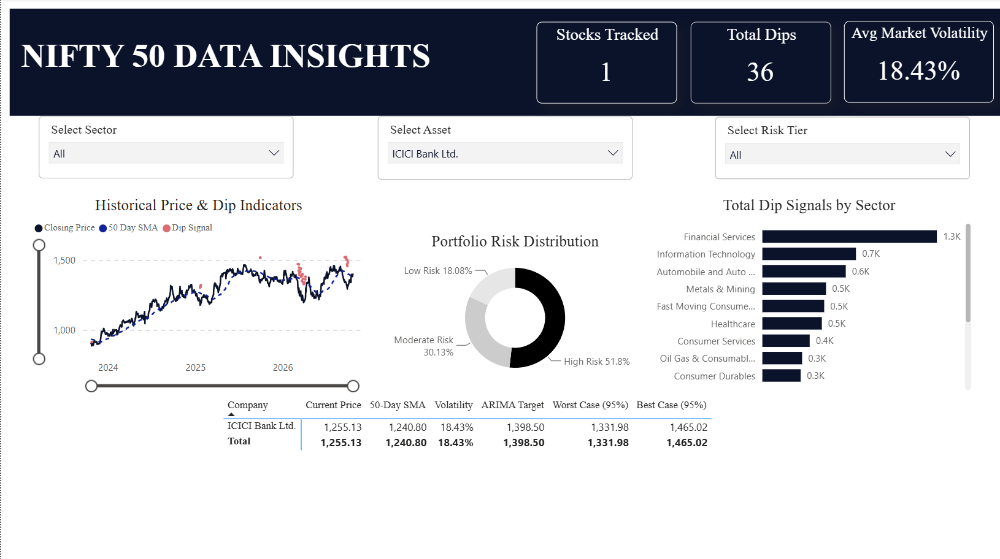

# Nifty 50 Predictive Analytics & Market Dashboard

## 📌 Project Overview
Most business intelligence projects rely strictly on historical data visualization. This project bridges the gap between pure data analytics and statistical machine learning by engineering an end-to-end pipeline that predicts forward-looking stock market movements for the Nifty 50 index. 

By integrating an **ARIMA time-series forecasting model (R)** with a **relational data model (Power BI)**, this dashboard allows users to analyze historical dip opportunities and project future price bounds for 50 distinct assets.

## ⚙️ Tech Stack & Architecture
* **Statistical Modeling:** R (`auto.arima`, `forecast` packages)
* **Business Intelligence & UI:** Power BI
* **Data Engineering & Logic:** DAX (Data Analysis Expressions), Power Query
* **Data Sources:** Historical Nifty 50 market data, Custom engineered Risk-Tier mappings.

## 🚀 Key Technical Features

### 1. R-Based Predictive Modeling (`auto.arima`)
Rather than relying on basic trend lines, I engineered an R script to execute time-series forecasting. The model processes historical closing prices, calculates moving averages, and outputs a 95% confidence interval (Best Case / Worst Case bounds) alongside a specific ARIMA Target price for forward-looking scenario analysis.

### 2. Relational Data Modeling (1-to-Many Architecture)
To prevent data duplication and broken aggregations, I constructed a star-schema relational model. The baseline historical dataset is linked via active 1-to-Many relationships to both custom Excel-based risk mappings and the R-generated forecast CSV (`Nifty50_ARIMA_Forecasts.csv`) on the `symbol` key. This ensures flawless cross-filtering across all visual elements.

### 3. Custom DAX Engineering
I bypassed default aggregations by writing custom DAX measures to define mathematical market behaviors:
* **Dip Signal Indicator:** A boolean logic measure that flags actionable buying opportunities strictly when the current closing price crosses below the 50-Day Simple Moving Average (SMA).
* **Non-Additive Aggregations:** Calculated dynamic rolling volatility and risk distributions that recalculate accurately regardless of slicer context.

### 4. Executive UI/UX Design
Designed a low-clutter, corporate-grade interface featuring synced visual interactions. The layout ensures that filtering a single asset isolates its specific price trend and ARIMA forecast, while maintaining the macro-level integrity of the portfolio's sector and risk distribution charts.

## 📁 Repository Structure
* `Nifty 50 Data Insights.pbix`: The complete, interactive Power BI file.
* `Data Analyst Project.R`: The R script used to generate the predictive data pipeline.
* `Nifty50_Engineered_History.csv`: The baseline historical stock data.
* `Nifty50_ARIMA_Forecasts.csv`: The predictive bounds generated by the R model.
* `Stock_Predictions.xlsx`: Custom engineered risk-tier mappings.
* `Dashboard_Preview.png`: High-resolution UI snapshot.

---
*Built for advanced data analytics and predictive modeling execution.*
